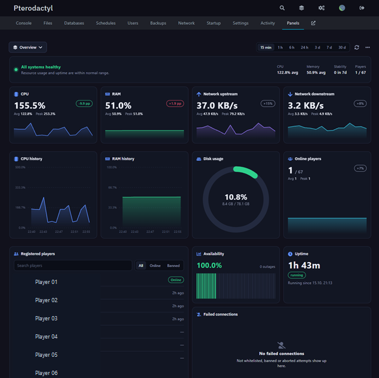
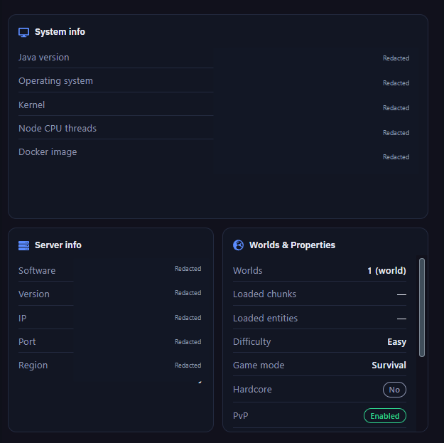
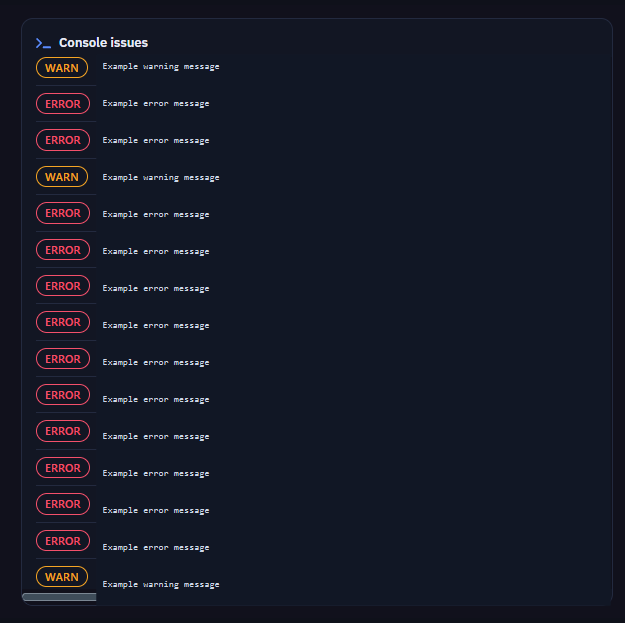

# MC Panels

A live Minecraft server dashboard for Pterodactyl.

| Overview | System Info | Console issues |
| --- | --- | --- |
|  |  |  |

...and many more

## Install or update

1. Install blueprint for your pterodactyl instance
2. Download `mcpanels.blueprint` and copy it to your Pterodactyl panel folder.
3. Run:

   ```bash
   cd /var/www/pterodactyl
   blueprint -install mcpanels
   ```

Run the same command to update an existing installation.

## Security and access keys

- The server owner and Pterodactyl root administrators can manage keys without a key of their own. The extension verifies ownership or the `root_admin` role.
- Create and revoke keys from **Panels → … → Access keys**. A key is shown only once; only its SHA-256 hash is stored in the server-root `mcpanels.credentials` file.
- Users must already be able to open that server in Pterodactyl. On the **Panels** page, open **… → Enter access key**, paste the key, and choose **Save key and connect**. It is saved in that browser for that server.
- Grants: `view` (dashboard), `edit` (layouts and profiles), `data.view`, `data.manage` (also views data), `ips.view` (player IP addresses), or `*` (all MC Panels permissions, including key management). Edit and data grants also include dashboard viewing.
- Keys do not grant Pterodactyl file, console, or power access. Use HTTPS and share keys securely.

## Available panels

| Panel | Description |
| --- | --- |
| Status bar | Server health, resource averages, stability, and players |
| Online players | Searchable current-player list |
| Online players — stat | Current online count, average, peak, and trend |
| Online players — history | Online-player count over time |
| Registered players | Player registry, bans, and IP history (permission required) |
| Registered players — stat | Registered-player count, average, peak, and trend |
| Registered players — history | Registered-player count over time |
| CPU — stat | Current CPU use, average, peak, and trend |
| CPU — history | CPU use over time |
| RAM — stat | Current memory use, average, peak, and trend |
| RAM — history | Memory use over time |
| Network upstream — stat | Current upload rate, average, peak, and trend |
| Network upstream — history | Upload rate over time |
| Network downstream — stat | Current download rate, average, peak, and trend |
| Network downstream — history | Download rate over time |
| TPS — stat | Current server ticks per second |
| TPS — history | TPS over time |
| Disk usage | Disk usage and warning thresholds |
| Uptime | Time since the latest server start |
| Availability | Uptime percentage and outages |
| Failed connections | Rejected joins grouped by reason |
| Console issues | Grouped console errors and warnings with per-panel regex filters |
| System info | Java and host operating-system details |
| Server info | Software, Minecraft version, address, and region |
| Worlds & Properties | World data and server properties |
| Note | Custom text and reminders |
| External link | Shortcut to a configured URL |

## Behavior notes

- The panel scheduler must be running for metrics and player history.
- TPS collection is disabled by default. Fabric needs a compatible plugin/mod HTTP endpoint for quiet bridge collection.
- IP history is collected from `logs/latest.log` when **Keep player IP history** is greater than `0`. Owners, root administrators, and keys with `ips.view` can see addresses.
- Dashboard animations and detailed debug logging are in the extension’s **General** settings. Dragging previews panels smoothly moving into place when animations are enabled.
- Data Explorer is limited to the current server; edits and deletions require confirmation.

## Development

```bash
npm install
npm run build
```

The build type-checks the dashboard and creates `dist/mcpanels.blueprint`.
