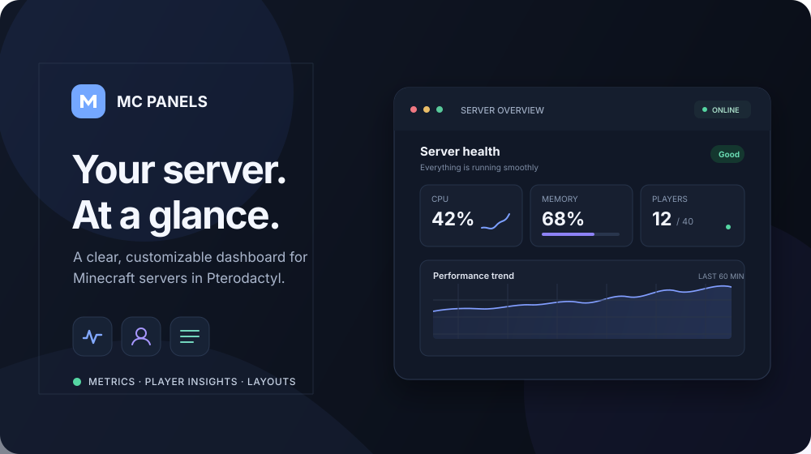

# MC Panels



A live Minecraft server dashboard for Pterodactyl.

| Overview | System Info | Console issues |
| --- | --- | --- |
|  |  |  |

...and many more

## Install or update

1. Install blueprint for your pterodactyl instance
2. Download `mcpanels.blueprint` and copy it to your Pterodactyl panel folder.
3. Run:

   ```bash
   cd /var/www/pterodactyl
   blueprint -install mcpanels
   ```

Run the same command to update an existing installation.

## Security and permissions

- Open **Panels → … → Permissions** to manage access for this server. Only the server owner and Pterodactyl root administrators can change permissions.
- **Server-wide defaults** apply to every signed-in Pterodactyl user who already has access to the server. Individual user grants add to these defaults.
- Grant additional permissions by the email address of an existing Pterodactyl account. The user must also be allowed to open the server in Pterodactyl; MC Panels permissions do not grant panel, console, file, or power access.
- Users without dashboard access can request it from the Panels page. Their request appears in the server's Permissions modal; approving grants dashboard view only. Grant more permissions separately when needed.
- Layout editing, profile management, data editing/deletion, and player IP access prompt for confirmation before they are granted. Data management also includes data viewing; elevated access includes dashboard viewing.

## Available panels

| Panel | Description |
| --- | --- |
| Status bar | Server health, resource averages, stability, and players |
| Online players | Searchable current-player list |
| Online players — stat | Current online count, average, peak, and trend |
| Online players — history | Online-player count over time |
| Registered players | Player registry, bans, and IP history (permission required) |
| Registered players — stat | Registered-player count, average, peak, and trend |
| Registered players — history | Registered-player count over time |
| CPU — stat | Current CPU use, average, peak, and trend |
| CPU — history | CPU use over time |
| RAM — stat | Current memory use, average, peak, and trend |
| RAM — history | Memory use over time |
| Network upstream — stat | Current upload rate, average, peak, and trend |
| Network upstream — history | Upload rate over time |
| Network downstream — stat | Current download rate, average, peak, and trend |
| Network downstream — history | Download rate over time |
| TPS — stat | Current server ticks per second |
| TPS — history | TPS over time |
| Disk usage | Disk usage and warning thresholds |
| Uptime | Time since the latest server start |
| Availability | Uptime percentage and outages |
| Failed connections | Rejected joins grouped by reason |
| Console issues | Grouped console errors and warnings with per-panel regex filters |
| System info | Java and host operating-system details |
| Server info | Software, Minecraft version, address, and region |
| Worlds & Properties | World data and server properties |
| Note | Custom text and reminders |
| External link | Shortcut to a configured URL |

## Behavior notes

- The panel scheduler must be running for metrics and player history.
- TPS collection is disabled by default. On Fabric 1.20.3+, use the vanilla `tick query` console command as the TPS source. Console queries add output to the server log; increase the TPS interval or configure an HTTP bridge for quiet collection.
- For command-based TPS collection, select the matching output format in **TPS and world data**: Fabric `tick query`, Forge `forge tps`, or `spark tps`. Spark output includes five TPS windows; MC Panels records the first (5-second) value. Custom output can use a PHP regex with named `tps` and optional `mspt` captures.
- IP history is collected from `logs/latest.log` when **Keep player IP history** is greater than `0`. Owners, root administrators, and keys with `ips.view` can see addresses.
- Dashboard animations and detailed debug logging are in the extension’s **General** settings. Dragging previews panels smoothly moving into place when animations are enabled.
- Data Explorer is limited to the current server; edits and deletions require confirmation.

## Development

```bash
npm install
npm run build
```

The build type-checks the dashboard and creates `dist/mcpanels.blueprint`.

### Adding a TPS command reader

Add a class implementing `Minecraft\TpsReaders\TpsReader` in `app/Minecraft/TpsReaders/` with a filename ending in `Format.php`. Implement `key()`, `label()`, `command()`, and `parse()`. The registry discovers these files automatically and builds the admin selection from each reader's label and command; no central list needs editing. `parse()` receives each cleaned log message plus per-scan state and settings, and should return `['type' => 'tps', 'value' => float|null, 'mspt' => float]` when it recognizes a reading. Use `TpsReading::fromMspt()` when the output only provides milliseconds per tick.
